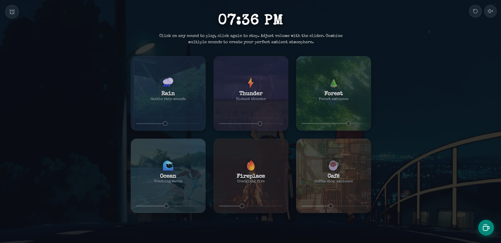

<div align="center">

# 🌿 Ambient Studio — Lofi Atmosphere & Focus Station

A minimalist, aesthetic ambient sound mixer inspired by lofi anime study stations. Designed for deep work, study sessions, and restful sleep with real acoustic loops, sleep timers, mindfulness tools, and intelligent mood presets.

### 🔗 [Live Demo](https://your-app.onrender.com) <!-- Replace with your live Render URL -->

<br />



</div>

---

## ✨ Features

### 🎧 Curated Ambient Layers
* **Rain**: Gentle rain sounds with an animated windowpane effect (`🌧️`)
* **Thunder**: Distant rumbling storm lightning (`⚡`)
* **Forest**: Sunlit pine forest canopy with gentle breeze (`🌲`)
* **Ocean**: Rhythmic ocean surf crashing on shore (`🌊`)
* **Fireplace**: Warm campfire bonfire with crackling embers (`🔥`)
* **Café**: Soft coffee shop chatter, espresso clinks, and murmur (`☕`)

### 🔊 Audio Architecture
* **High-Fidelity Loops**: Real, seamless `.mp3` audio files included in `/sounds/`.
* **Procedural Synthesis Fallback**: Built-in **Web Audio API** engine generates realistic acoustic noise buffers and harmonic oscillators, ensuring the app works offline without network dependencies.
* **Natural Volume Drift**: Subtle volume fluctuation simulating realistic wind gusts and rain intensity.
* **Volume Persistence**: Remembers your preferred slider levels automatically in `localStorage`.

### ⏱️ Sleep & Focus Timer
* **Expandable Numeric Input**: Click the top-left alarm clock (`⏰`) to set `[HH] : [MM] : [SS]`.
* **Smooth 2.5-Second Fade-Out**: Audio gently glides down to zero rather than abruptly cutting off.
* **Tibetan Singing Bowl Chime**: Synthesizes a calming $528\text{Hz}$ Solfeggio bell chime when time is up.
* **Session Complete Toast**: Floating banner with one-click **[Restart]** and **[Resume]** actions.

### 🎨 Retro Lofi Aesthetics
* **Distressed Typewriter Font**: Google Fonts (`Special Elite`) across all clock, title, and subtitle elements.
* **Anime Overlook Backdrop**: Fullscreen city overlook scene with atmospheric vignette overlays.
* **Hollow Ring Sliders**: Exact circular slider rings with illuminated active progress tracks.
* **One-Click Quick Reset (↺)**: Instantly pauses all tracks, clears timers, and resets volume bars back to their default reference positions.
* **Master Mute Button**: Top-right speaker button with instant keyboard shortcut (<kbd>Spacebar</kbd>).

### ☕ Atmosphere Studio (Bottom-Right Action Button)
* **AI Atmosphere Curator**: Type any custom mood (e.g. *"studying in a warm wooden cabin during rain"*) to calculate the mix.
* **One-Click Presets**: *Midnight Study*, *Stormy Coast*, *Cozy Cabin Hearth*, and *Peaceful Sleep*.
* **Box Breathing Coach**: 4-second inhale, 4-second hold, 4-second exhale relaxation tool.
* **Shareable Soundscapes**: Encode and share your mix via URL parameters (e.g. `?rain=50&fire=30`).

---

## ⌨️ Keyboard Shortcuts

| Shortcut | Action |
| :--- | :--- |
| <kbd>Spacebar</kbd> | Toggle Mute / Unmute all playing sounds |
| <kbd>Click Card</kbd> | Toggle individual sound on or off |
| <kbd>Drag Slider</kbd> | Adjust individual volume (0% – 100%) |

---

## 🚀 Quick Start (Local Setup)

### Prerequisites
* [Node.js](https://nodejs.org/) (version 18 or higher recommended)

### 1. Clone & Install
```bash
git clone https://github.com/<your-username>/ambient-ai-mixer.git
cd ambient-ai-mixer
npm install
```

### 2. Run the Development Server
```bash
npm run dev
```
Open `http://localhost:5173` in your browser.

### 3. Build for Production
```bash
npm run build
```
The optimized production build will be generated in `./dist`.

---

## 🛠️ Tech Stack

* **Framework**: [React 18](https://react.dev/) + [Vite](https://vitejs.dev/)
* **Audio Engine**: Web Audio API + HTML5 Audio Elements
* **Icons**: [Lucide React](https://lucide.dev/)
* **Typography**: Google Fonts (*Special Elite*)
* **Styling**: Modern CSS Glassmorphism + Flexbox / Grid

---

## 📄 License

MIT License — feel free to use, modify, and build upon this project for your own portfolio or personal use.
